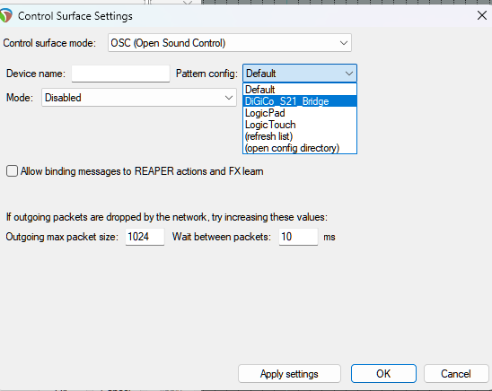

# DiGiCo S21 <-> REAPER OSC Bridge

Standalone Windows bridge that connects a **DiGiCo S21** console over
**Ethernet (OSC)** to **REAPER DAW** for real-time fader, pan, mute,
solo, and track-name sync.

Download the ready-to-run app from the
[Releases](../../releases) page (`DiGiCo_S21_REAPER_OSC_Bridge.exe`,
no Python needed), or run it from source.

## Features

- Bi-directional OSC translation between the S21 and REAPER
  (direction selectable: S21 -> REAPER, REAPER -> S21, or both)
- Three DiGiCo address profiles (Standard `/Input_Channels/{ch}/...`,
  SD prefix, Flat), with editable paths for other firmware layouts
- Fader scale in dB or normalized, pan scale bipolar / normalized / MIDI
- Track offset and channel count settings, echo-lock against feedback loops
- One-click install of the `DiGiCo_S21_Bridge.ReaperOSC` pattern into
  REAPER (64 tracks)
- Python standard library only

## Quick Setup

1. **Ethernet:** Connect the DiGiCo S21 rear Ethernet port to your PC on
   the same subnet (e.g. S21 `192.168.1.21`, PC `192.168.1.50`,
   mask `255.255.255.0`).
2. **DiGiCo S21 (V3.0+):**
   - Go to **Extensions -> OSC Control** (or **System -> External Control**).
   - Enable OSC = **YES**, S21 Receive Port = `8000`.
   - **Add New Controller** -> IP = your PC IP, Send Port = `8001`.
3. **REAPER:**
   - Open `DiGiCo_S21_REAPER_OSC_Bridge.exe` and click
     **Install REAPER .ReaperOSC** (installs `DiGiCo_S21_Bridge.ReaperOSC`
     into `%APPDATA%\REAPER\OSC\`).
   - In REAPER: **Options -> Preferences -> Control/OSC/web -> Add**,
     then set **Control surface mode: OSC (Open Sound Control)** and
     **Pattern config: DiGiCo_S21_Bridge**:

     

   - Local listen port: `9000`
   - Device IP: `127.0.0.1`
   - Device port: `9001`
4. **Start the bridge** and check the log pane. If the S21 sends paths
   the bridge does not recognise, it prints them as UNMAPPED so you can
   copy them into the Path fields.

**Live tip:** keep Direction on **`s21_to_reaper`** during live services
so S21 faders, pans, and mutes control REAPER with zero risk of REAPER
moving the S21's motorized faders.

## Run from source

```
python app_gui.py
```

Requires Python 3.10+ (standard library only, Tkinter included).

## Build the exe

```
pip install pyinstaller
pyinstaller DiGiCo_S21_REAPER_OSC_Bridge.spec
```

The executable lands in `dist/`.

## Tests

```
python test_bridge.py
```

Automated UDP loopback tests for the OSC codec and bridge engine.

## Files

- `app_gui.py` — desktop GUI
- `bridge_engine.py` — OSC translation engine
- `osc_codec.py` — OSC encode/decode
- `reaper_osc_profile.py` — REAPER pattern generation/install
- `test_bridge.py` — loopback tests

## Author

**Donyoku**
